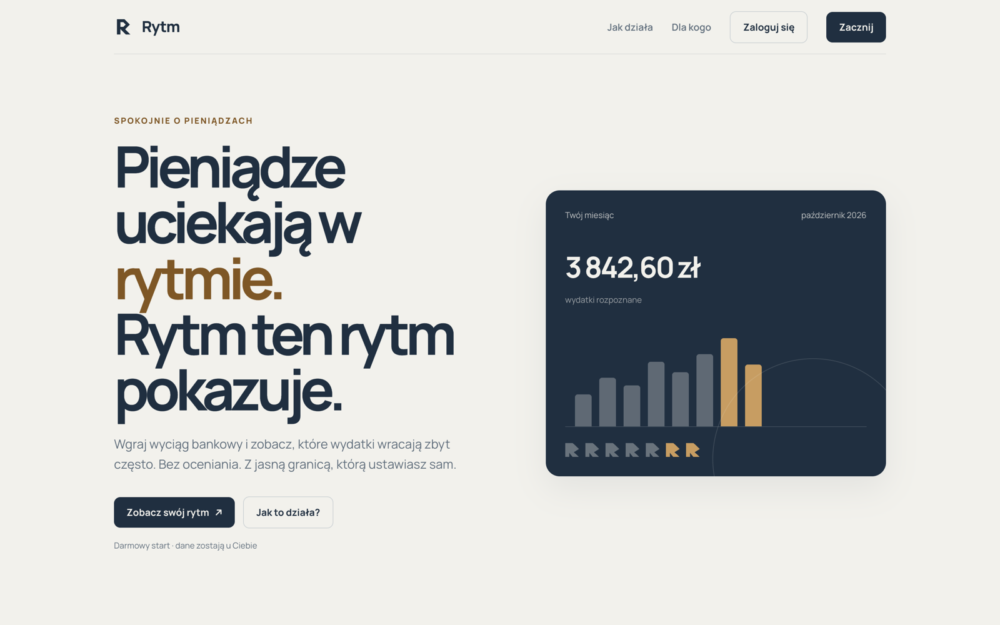
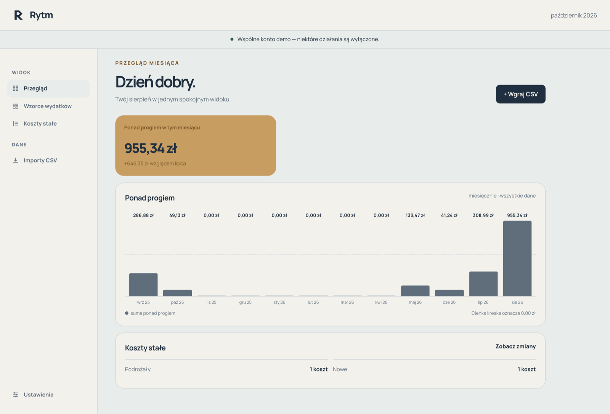
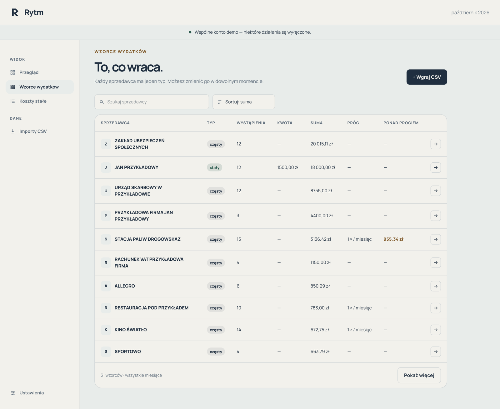
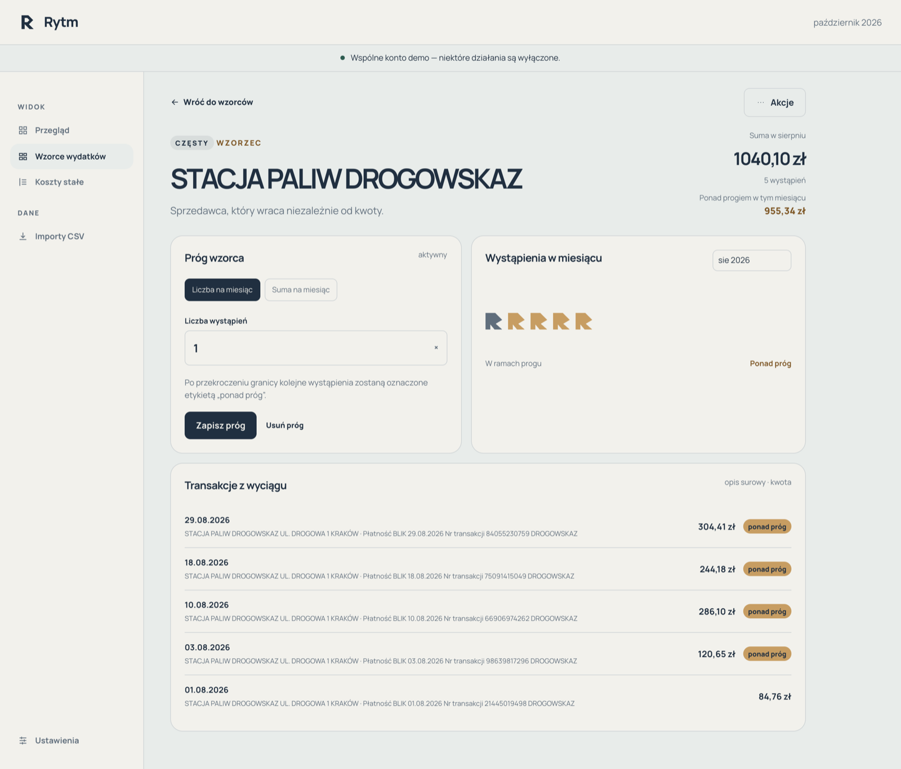
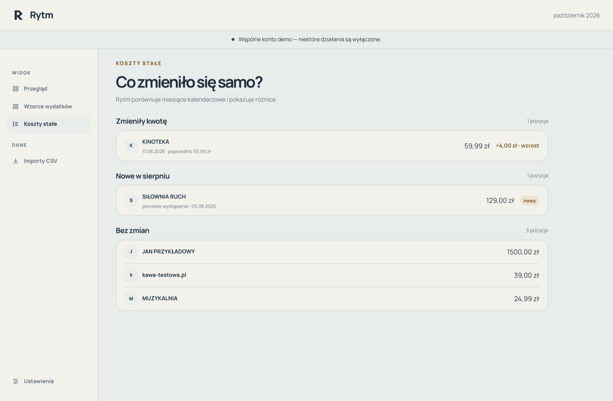
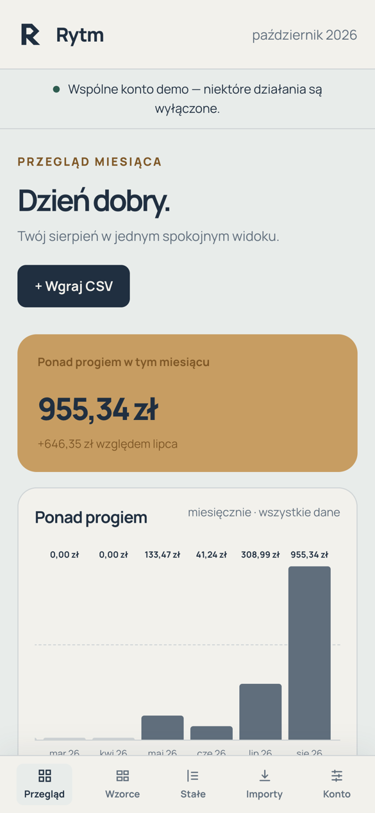
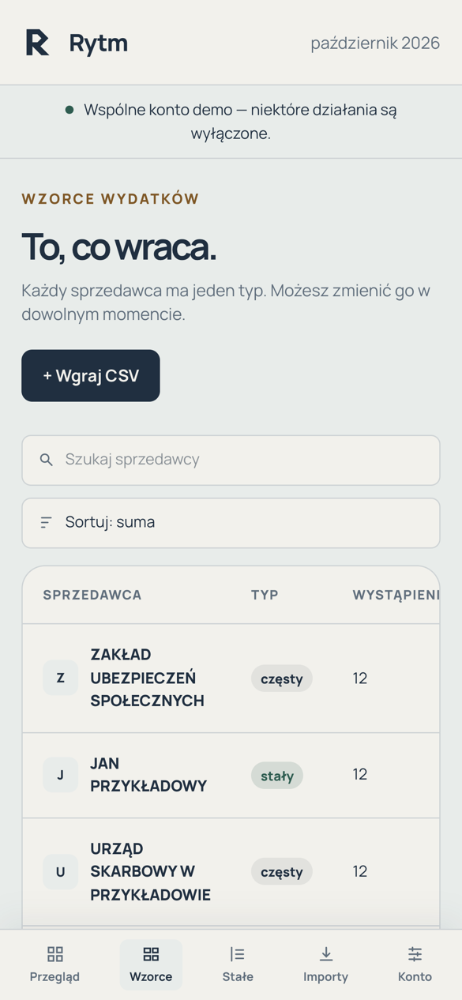
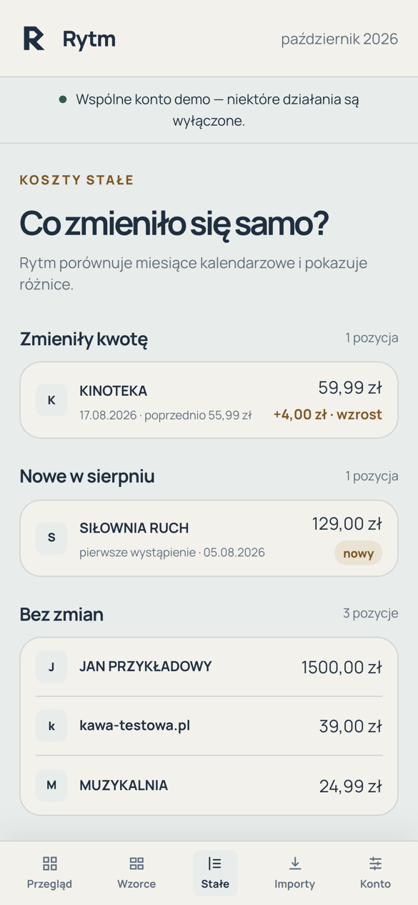

<div align="center">

<picture>
  <source media="(prefers-color-scheme: dark)" srcset="public/rytm/brand/rytm-logo-bialy.svg">
  
</picture>

### Pieniądze uciekają w rytmie. Rytm ten rytm pokazuje.

Wgraj wyciąg bankowy i zobacz, które wydatki wracają zbyt często.<br>
Bez oceniania. Z jasną granicą, którą ustawiasz sam.

**[Wypróbuj demo →](https://rytm.ariom.cloud)** · [Jak to działa](#jak-to-działa) · [Dla deweloperów](#dla-deweloperów)

<br>



</div>

---

## Problem, który zna każdy

Koniec miesiąca. Patrzysz na saldo i masz poczucie, że coś ucieka — ale nie wiesz co. Bank dzieli wydatki na kategorie, tylko że kategoria nie odpowiada na pytanie, które naprawdę cię nurtuje: **co z tego było zbędne?**

Rytm odpowiada inaczej. **Zbędne to nie kategoria, tylko nadwyżka powtórzeń ponad twój własny próg.** Kawa nie jest zbędna. Piąta kawa w tygodniu — już tak.

<table>
<tr>
<td width="33%" valign="top">

### 🔁 Widzi powtórzenia

Wykrywa wzorce w historii konta: **stałe** (subskrypcje, raty, opłaty — ten sam sprzedawca i podobna kwota) oraz **częste** (Wolt, stacja paliw, kino — ten sam sprzedawca, dowolna kwota).

</td>
<td width="33%" valign="top">

### 🎚️ Granica jest twoja

Na każdym wzorcu ustawiasz próg: liczbę wystąpień albo sumę na miesiąc. Wszystko ponad nim Rytm oznacza jako **„ponad próg”** — i sumuje.

</td>
<td width="33%" valign="top">

### 📈 Pokazuje, co się zmieniło samo

Podwyżka abonamentu o 4 zł? Nowa subskrypcja, o której zapomniałeś? Rytm porównuje miesiące i wyciąga to na wierzch.

</td>
</tr>
</table>

## Jeden spokojny widok na miesiąc

Przegląd odpowiada na jedno pytanie: **ile w tym miesiącu wydałem ponad własne granice** — i czy to więcej, czy mniej niż miesiąc wcześniej. Trend z całego roku pokazuje, czy nawyki naprawdę się zmieniają.

<p align="center">
  
</p>

## To, co wraca

Wszyscy sprzedawcy, u których płacisz regularnie, w jednej tabeli: typ wzorca, liczba wystąpień, suma, twój próg i kwota ponad nim. Szukaj, sortuj, zmieniaj typ jednym kliknięciem.

<p align="center">
  
</p>

## Próg, który widać

Ustaw „1 tankowanie miesięcznie” i od razu zobacz, które transakcje go przekroczyły. Każda pozycja z wyciągu ma swoją etykietę, więc zawsze wiesz, **dlaczego** coś trafiło ponad próg — żadnej czarnej skrzynki.

<p align="center">
  
</p>

## Co zmieniło się samo?

Koszty stałe mają to do siebie, że rosną po cichu. Rytm porównuje miesiące kalendarzowe i pokazuje osobno: **co podrożało**, **co jest nowe** i co zostało bez zmian.

<p align="center">
  
</p>

## W kieszeni też

Pełna wersja mobilna z dolną nawigacją — sprawdzisz swój rytm w tramwaju, nie tylko przy biurku.

<p align="center">
  
  &nbsp;
  
  &nbsp;
  
</p>

## Jak to działa

1. **Pobierz wyciąg CSV** z bankowości internetowej — obsługiwane są **ING Bank Śląski** i **Santander Bank Polska** (konta w PLN). Format banku Rytm rozpoznaje sam.
2. **Wgraj plik.** Przed zatwierdzeniem widzisz zakres dat i rachunek. Ponowne wgranie nakładającego się okresu nie zdubluje transakcji, a każdy import da się cofnąć.
3. **Ustaw progi** na wzorcach, które cię interesują. Bez ręcznego kategoryzowania, bez arkusza — wystarczy jeden wieczór w miesiącu.

Ten sam wyciąg i te same progi zawsze dają ten sam wynik. Reguły są proste i jawne, więc wiesz, skąd wzięła się każda liczba.

## Prywatność

- Dane każdego konta są odizolowane na poziomie bazy (Row Level Security w Postgresie) — nikt poza tobą ich nie odczyta.
- Usunięcie konta usuwa razem z nim wszystkie importy, transakcje, progi i decyzje.
- Prawdziwe wyciągi nigdy nie trafiają do repozytorium ani do demo — testy i konto demo działają wyłącznie na syntetycznych danych.

## Demo

Wersja produkcyjna: **https://rytm.ariom.cloud** (polski i angielski — przełącznik w stopce).

Konto demo działa wyłącznie na syntetycznym wyciągu ING (12 miesięcy, fikcyjne transakcje) — żadnych prawdziwych danych.

- E-mail: `demo@rytm.example`
- Hasło: `Rytm-Demo-e3GGeT1UFm-2026`

Konto jest wspólne dla wszystkich recenzentów, dlatego zmiana hasła, usunięcie konta, cofnięcie importu i wgranie kolejnego wyciągu są wyłączone. Progi i decyzje o wzorcach działają — to, co zobaczysz, mógł już zmienić ktoś inny.

---

## Dla deweloperów

**Stos:** [Astro 7](https://astro.build) (SSR) · React 19 · Tailwind 4 · shadcn/ui · [Supabase](https://supabase.com) (Postgres, Auth, RLS) · Docker + Caddy na VPS · Vitest · pgTAP · GitHub Actions

### Uruchomienie lokalne

Wymagania: Node.js 22 (`.nvmrc`), Docker Desktop.

```bash
cp .env.example .env      # wartości lokalnego Supabase — nigdy produkcji
npm ci
npx supabase start        # Postgres, Auth i Mailpit w Dockerze; seed tworzy konta testowe
npm run dev               # http://localhost:4321
npm run smoke             # musi skończyć się „All smoke steps passed”
```

Konto testowe z seeda: `test@rytm.local` / `Rytm-Test-Passw0rd!`.

### Komendy

| Komenda                | Co robi                                                                                   |
| ---------------------- | ----------------------------------------------------------------------------------------- |
| `npm run dev`          | serwer deweloperski                                                                       |
| `npm run build`        | build produkcyjny (`@astrojs/node`, `dist/server/entry.mjs`)                              |
| `npm run start`        | uruchamia build produkcyjny (`HOST`, `PORT` i zmienne Supabase z otoczenia procesu)       |
| `npm run lint`         | ESLint z regułami opartymi na typach                                                      |
| `npm test`             | testy jednostkowe Vitest — parsery ING/Santander na fixture'ach, detektor formatu, wzorce |
| `npx supabase test db` | testy bazy w pgTAP — izolacja RLS, kaskada usuwania konta, ograniczenia                   |
| `npm run smoke`        | test całego przepływu (rejestracja, logowanie, import, wzorce) na działającym serwerze    |
| `npm run db:types`     | regeneracja typów bazy po migracji                                                        |

### CI/CD

Każdy PR przechodzi `ci` (lint, typy, testy, build) i `smoke` (pgTAP + smoke na lokalnym Supabase). Merge do `main` buduje obraz `ghcr.io/vince307/rytm:<sha>` i uruchamia `deploy`: migracje na hostowanej bazie, potem wdrożenie kontenera na VPS (Caddy → `https://rytm.ariom.cloud`, health `GET /api/health`, automatyczny powrót do poprzedniego obrazu, gdy health check nie przejdzie). Osobny workflow raz dziennie pinguje bazę, żeby darmowy projekt Supabase nie usypiał.

Szczegóły architektury i zasady pracy z repozytorium: [`CLAUDE.md`](CLAUDE.md). Stan wdrożenia i sekrety: [`context/deployment/deploy-plan.md`](context/deployment/deploy-plan.md).

<div align="center">
<br>

<br>
<sub>Spokojnie o pieniądzach.</sub>
</div>
